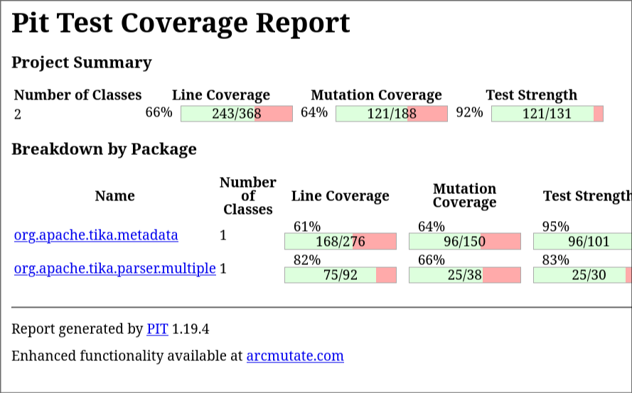
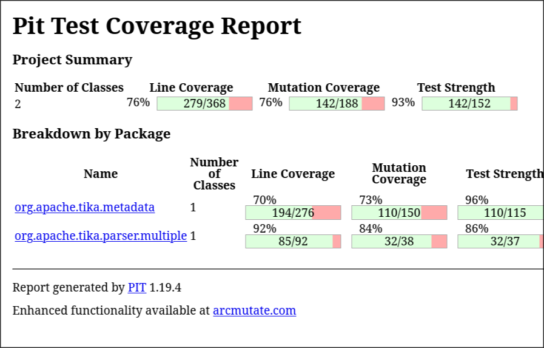
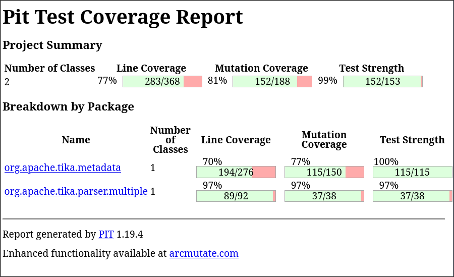

# Tâche 2 : génération de tests avec ChatUniTest et analyse de mutation avec pitest

**Binôme :** BITULEANU Andrei, LITRE Paul 
**Matricule :** 20275298        , 20267456
**Cours :** IFT3913  
**Date :** 12 octobre 2026

---

## 1. Environnement et outils

| Élément | Valeur (PC 1) | PC 2 |
|---|---|---|
| Système d'exploitation | Arch Linux | Windows 11 |
| Machine utilisée pour la génération | ThinkPad T480 | Asus TUF Gaming |
| Modèle de langage local | qwen2.5-coder:3b | |
| Module Tika testé | tika-core | |

### Configuration de ChatUniTest

```xml
  <plugin>
        <groupId>io.github.zju-aces-ise</groupId>
        <artifactId>chatunitest-maven-plugin</artifactId>
        <version>2.1.1</version>
        <configuration>
          <apiKeys>xxx</apiKeys>
          <model>qwen2.5-coder:3b</model>
          <url>http://localhost:11434/v1/chat/completions</url>
          <thread>false</thread>
          <testNumber>3</testNumber>
          <maxRounds>3</maxRounds>
        </configuration>
      </plugin>
```

---

## 2. Classes sélectionnées

| # | Classe (nom complet) | Fichier de tests existant | Couverture instructions | Couverture branches | Justification du choix |
|---|---|---|---|---|---|
| 1 | org.apache.tika.metadata.Metadata | TestMetadata.java | 61 % (94 manquées sur 260) | 57 % (52 manquées sur 122) | Classe centrale du package `metadata` (stockage et lecture des métadonnées d'un document), déjà testée mais loin de 100 % : 94 lignes sur 260 non exécutées et 11 méthodes sur 45 jamais appelées, ce qui laisse beaucoup de marge aux tests générés. Son comportement est simple à spécifier (ajout, lecture, remplacement de valeurs, clés multiples, types de propriétés), donc les oracles sont faciles à établir et à comparer entre tests IA et tests manuels. |
| 2 | org.apache.tika.parser.multiple.AbstractMultipleParser | MultipleParserTest.java | 85 % (58 manquées sur 406) | 76 % (12 manquées sur 50) | Seule classe de son package à ne pas être à 100 % (ses sous-classes `FallbackParser` et `SupplementingParser` le sont) ; logique de décision non triviale (politiques de métadonnées, enchaînement de parseurs), donc riche en cas limites et en oracles à comparer entre IA et tests manuels. |

---

## 3. Génération automatique des tests avec ChatUniTest

### 3.1 Procédure

Commandes exécutées pour chaque classe :

```bash
cd tika-core
mvn chatunitest:class -DselectClass=...
mvn chatunitest:copy
mvn test -Dtest=...
```

Le PC Linux ne possédant pas de GPU, les tests générés par ChatUniTest sont lents à générer ; on utilise donc `-DtestNumber=1` et `-DmaxRounds=1`.

Malgré cela, après 41 min 53 s, seulement 2 itérations d'un même test ont été générées et aucune des deux versions ne compile. Nouvelle tentative sur un nouvel ordinateur.

On essaie donc sur un autre ordinateur, un Windows possédant un GPU Nvidia GeForce 3050. Là, on arrive à générer 3 tests pour chaque classe ; cependant, aucun des 6 tests ne compile. Et le tout après près de 3 h.

Finalement, sur ce même ordinateur, on arrive à générer 2 tests, 1 pour chaque classe.

Les logs de l'exécution sont à la racine du module tika-core et s'appellent :

```
Log complet : [chatunitest-run1.log](tika-core/chatunitest-run1.log)
Log complet : [chatunitest-run2.log](tika-core/chatunitest-run1.log)
```

### 3.2 Résultats par classe

#### Classe 1 : `Metadata`

- Nombre de tests générés : 1
- Durée de génération : 1 h 30
- **Compilent-ils sans intervention manuelle ?** non
- S'exécutent-ils et passent-ils sans intervention manuelle ? Non

#### Classe 2 : `AbstractMultipleParser`

- Nombre de tests générés : 1
- Durée de génération : 1 h 30
- Compilent-ils sans intervention manuelle ? Non
- S'exécutent-ils et passent-ils sans intervention manuelle ? Non

### 3.3 Synthèse de la génération

La synthèse de tests avec ChatUniTest peut faire gagner un temps précieux en générant des tests pour nos classes, mais il est préférable de l'utiliser avec l'API d'OpenAI, à moins de posséder un PC très puissant ou beaucoup de temps, car sinon les temps de génération peuvent être très longs (~10 min pour chaque essai de génération d'un test) et les tests générés sont souvent de mauvaise qualité et ne compilent pas. C'est pourquoi nous avons utilisé le modèle chatgpt-4o qui n'est donc pas un modèle locale pour générer les tests. Ce sont les tests dans MetadataExtraTest et AbstractManualParserExtraTest 

---

## 4. Comparaison qualitative des oracles : IA contre tests écrits à la main

| Aspect | Tests écrits à la main (existants) | Tests écrits avec l'aide de l'IA (10 par classe) |
|---|---|---|
| Type d'assertions utilisées | Surtout `assertEquals` (≈ 70 dans `TestMetadata`, ≈ 25 dans `MultipleParserTest`), puis `assertTrue`/`assertFalse`, `assertNull`, `assertNotNull`, `assertContains` ; `assertThrows` très rare (2 occurrences) | Plus variées : `assertEquals`, `assertArrayEquals`, `assertSame`, `assertNull`, `assertFalse`/`assertTrue` et surtout `assertThrows` (15 occurrences) pour vérifier les exceptions |
| Précision des valeurs attendues | Valeurs concrètes et exactes (dates ISO, tableaux de valeurs, noms de classes des parseurs utilisés, textes produits par les parseurs) | Valeurs exactes également (valeur d'un `long` supérieur à `Integer.MAX_VALUE`, ordre des valeurs fusionnées, liste des types supportés), calculées à partir de la documentation et du code ; aucun test ne se contente de `assertNotNull` seul |
| Cas limites et erreurs couverts | Cas nominaux bien couverts (ajout, lecture, suppression, dates avec ou sans fuseau, accès concurrents, limiteur d'écriture, politiques `FALLBACK` et `SUPPLEMENT`) ; peu de cas d'erreur | Cas limites et erreurs ciblés : entier absent, non numérique ou trop grand, mauvais type de propriété, ajout d'une 2ᵉ valeur à une propriété simple, `DISCARD_ALL` refusé par `SupplementingParser`, `RuntimeException` encapsulée, liste de parseurs non modifiable |
| Vérifications triviales ou redondantes | Quelques redondances (`TestMetadata` répète plusieurs fois la même séquence d'`assertEquals`) ; `MultipleParserTest` n'a que 3 tests, donc beaucoup d'assertions par test | Pas de vérification triviale, mais un test peut mélanger plusieurs comportements (ex. `testToString`) ; certains chevauchent des tests existants (`testEqualsAndHashCodeForSameContent`) |
| Lisibilité et nommage | Noms courts (`testAdd`, `testSet`, `testFallback`) ; tests longs qui vérifient plusieurs scénarios à la suite, donc plus difficiles à diagnostiquer en cas d'échec | Noms longs et explicites qui décrivent le comportement attendu (`testMergeFirstWinsKeepsOldOnClash`) ; un test = un comportement, avec des classes d'aide (`ScriptedParser`, `StopImmediatelyParser`) |
| Faiblesses communes | Les deux jeux de tests ne vérifient pas la **valeur** de `hashCode` ni les appels de crochets internes (`parserPrepare`, `enableRewind`) : d'où les 10 mutants survivants du §5.5 | Idem : les mutants survivants du §5.5 restent vivants avec ces tests seuls, ce qui a motivé les tests manuels du §6 |

## 5. Analyse de mutation avec pitest

### 5.1 Configuration de pitest

```xml
<plugin>
        <groupId>org.pitest</groupId>
        <artifactId>pitest-maven</artifactId>
        <version>1.19.4</version>
        <dependencies>
          <dependency>
            <groupId>org.pitest</groupId>
            <artifactId>pitest-junit5-plugin</artifactId>
            <version>1.2.3</version>
          </dependency>
        </dependencies>
        <configuration>
          <targetClasses>
            <param>org.apache.tika.metadata.Metadata*</param>
            <param>org.apache.tika.parser.multiple.AbstractMultipleParser*</param>
          </targetClasses>
          <targetTests>
            <param>org.apache.tika.metadata.*</param>
            <param>org.apache.tika.parser.multiple.*</param>
          </targetTests>
          <threads>2</threads>
          <timestampedReports>false</timestampedReports>
          <outputFormats>
            <param>HTML</param>
            <param>XML</param>
          </outputFormats>
        </configuration>
      </plugin>
```

Commande exécutée :

```bash
mvn org.pitest:pitest-maven:mutationCoverage -pl tika-core ...
```

### 5.2 Score de mutation avec les tests originaux uniquement



| Classe | Mutants générés | Tués | Survivants | Sans couverture | Score de mutation |
|---|---|---|---|---|---|
| `org.apache.tika.metadata.Metadata` | 150 | 96 | 5 | 49 | 64 % |
| `org.apache.tika.parser.multiple.AbstractMultipleParser` | 38 | 25 | 5 | 8 | 66 % |
| **Total** | 188 | 121 | 10 | 57 | 64 % (force des tests : 92 %) |

*Mesure faite avec pitest 1.19.4 sur `tika-core`, avant l'ajout de nos tests.*

### 5.3 Score de mutation avec les nouveaux tests (originaux + générés)



| Classe | Mutants générés | Tués | Survivants | Sans couverture | Score de mutation | Évolution |
|---|---|---|---|---|---|---|
| `Metadata` | 150 | 110 | 5 | 35 | 73 % | +9 points |
| `AbstractMultipleParser` | 38 | 32 | 5 | 1 | 84 % | +18 points |
| **Total** | 188 | 142 | 10 | 36 | 76 % (force des tests : 93 %) | +12 points |

### 5.4 Les tests générés détectent-ils tous les mutants ?

**Réponse : non.** Ils détectent 21 mutants de plus que les tests d'origine, mais surtout parce qu'ils exécutent du code qui n'était pas exécuté du tout : les mutants « sans couverture » passent de 57 à 36. En revanche, **les 10 mutants survivants de départ n'ont pas bougé** : ils sont exécutés par les tests, mais aucun oracle ne vérifie ce qu'ils modifient.

| Mutant (classe, ligne, mutateur) | Détecté ? | Test qui le détecte | Explication |
|---|---|---|---|
| `AbstractMultipleParser.mergeMetadata`, l. 105 et 112-118, négation de conditions | Oui | `testMergeFirstWinsKeepsOldOnClash`, `testMergeNeverTouchesTrackingKeys`... | Les tests fixent précisément les valeurs fusionnées selon la politique. |
| `AbstractMultipleParser.getSupportedTypes` | Oui | `testSupportedTypesIsUnionOfAllParsers` | Compare l'ensemble exact des types offerts. |
| `Metadata.getInt`, cas invalides | Oui | `testGetIntReturnsNullWhenMissingOrInvalid` | Vérifie `null` pour une valeur absente, non numérique ou trop grande. |
| `Metadata.set(Property, Calendar)` | Oui | `testSetCalendar` | Compare la chaîne de date exacte (`2024-03-15T10:20:30Z`). |
| `Metadata.hashCode`, l. 748-754 | **Non** | — | Les tests ne vérifient que l'égalité de deux hachages, pas leur valeur. |
| `AbstractMultipleParser.parse`, l. 248, 272, 281, 311 | **Non** | — | Les tests vérifient le résultat final, pas le rembobinage du flux, l'appel du hook ni l'état intermédiaire. |

### 5.5 Mutants survivants

| # | Classe, ligne | Mutation | Cause de la survie | Équivalent ? |
|---|---|---|---|---|
| 1 | `Metadata`, l. 480 | `set(Property, String)` : appel `set(property.getPrimaryProperty(), value)` supprimé (propriété composite) | Aucun test ne vérifie la valeur de la propriété principale d'une propriété composite | Non |
| 2 | `Metadata`, l. 748 | `hashCode` : addition remplacée par soustraction | Seule l'égalité des hachages de deux objets égaux est testée | Non |
| 3 | `Metadata`, l. 750 | `hashCode` renvoie 0 | Idem | Non |
| 4 | `Metadata`, l. 754 | `getMetadataEntryHashCode` renvoie 0 | Idem | Non |
| 5 | `Metadata`, l. 754 | XOR remplacé par AND | Idem | Non |
| 6 | `AbstractMultipleParser`, l. 248 | `tis.enableRewind()` supprimé | Les tests utilisent un flux déjà rembobinable | Non |
| 7 | `AbstractMultipleParser`, l. 272 | Appel de `parserPrepare` supprimé | Aucun test ne s'appuie sur ce hook | Non |
| 8 | `AbstractMultipleParser`, l. 281 | `recordParserFailure(p, e, metadata)` supprimé | L'erreur est aussi enregistrée sur l'objet d'origine, donc le résultat final est identique | Non |
| 9 | `AbstractMultipleParser`, l. 311 | `tis.rewind()` supprimé | Les parseurs de test ne lisent pas le flux | Non |
| 10 | `AbstractMultipleParser`, l. 314 | `tmp.dispose()` supprimé | `tmp` est créé mais aucune ressource n'y est jamais enregistrée : le comportement est identique | **Oui** |


---

## 6. Tests ajoutés manuellement pour les mutants survivants

Fichiers : `MetadataManualTest.java` (paquet `org.apache.tika.metadata`) et `AbstractMultipleParserManualTest.java` (paquet `org.apache.tika.parser.multiple`). Chaque test a été vérifié en appliquant à la main la mutation visée sur une copie du code, puis en exécutant le test : il échoue (mutant tué), puis passe sur le code d'origine.

### Test 1 : `testSetCompositePropertyWritesPrimaryAndSecondary`

| Élément | Description |
|---|---|
| **Classe de test et méthode** | `MetadataManualTest`, `testSetCompositePropertyWritesPrimaryAndSecondary` |
| **Mutant(s) ciblé(s)** | §5.5 n° 1 |
| **Intention du test** | Vérifier qu'écrire une propriété composite renseigne la propriété principale **et** les propriétés secondaires |
| **Motivation des données de test** | Une propriété principale (`manual:primary`) et une secondaire (`manual:secondary`), distinctes, pour savoir laquelle a reçu la valeur ; valeur « value » |
| **Explication de l'oracle** | Selon la Javadoc de `Property.composite`, la valeur est écrite dans la propriété principale et dans les propriétés d'extraction secondaires : on attend la même valeur pour les deux et 2 clés au total |

```java
Property composite = Property.composite(primary, new Property[]{secondary});
Metadata m = new Metadata();
m.set(composite, "value");
assertEquals("value", m.get(primary));
assertEquals("value", m.get(secondary));
assertEquals(2, m.size());
```

### Test 2 : `testHashCodeOfSingleEntryIsNotZero`

| Élément | Description |
|---|---|
| **Classe de test et méthode** | `MetadataManualTest`, `testHashCodeOfSingleEntryIsNotZero` |
| **Mutant(s) ciblé(s)** | §5.5 n° 3 et 4 (renvoi de 0) |
| **Intention du test** | Un `Metadata` non vide ne doit pas avoir un hachage nul |
| **Motivation des données de test** | Une seule entrée `a` → `1`, pour calculer la valeur attendue à la main |
| **Explication de l'oracle** | Formule du code : `hash(clé) ^ Arrays.hashCode(valeurs)`. `"a".hashCode()` = 97 ; `Arrays.hashCode({"1"})` = 31 + 49 = 80 ; 97 ^ 80 = 49 |

```java
Metadata m = new Metadata();
m.add("a", "1");
assertEquals(49, m.hashCode());
```

### Test 3 : `testHashCodeCombinesKeyAndValuesWithXor`

| Élément | Description |
|---|---|
| **Classe de test et méthode** | `MetadataManualTest`, `testHashCodeCombinesKeyAndValuesWithXor` |
| **Mutant(s) ciblé(s)** | §5.5 n° 5 (XOR → AND) |
| **Intention du test** | Distinguer le XOR du ET binaire dans le hachage d'une entrée |
| **Motivation des données de test** | Même entrée `a` → `1` : 97 ^ 80 = 49 alors que 97 & 80 = 64, donc les deux opérateurs donnent des résultats différents |
| **Explication de l'oracle** | Calcul à la main de la formule d'origine (XOR) |

```java
assertNotEquals(97 & 80, m.hashCode());
assertEquals(97 ^ 80, m.hashCode());
```

### Test 4 : `testHashCodeIsSumOfEntryHashCodes`

| Élément | Description |
|---|---|
| **Classe de test et méthode** | `MetadataManualTest`, `testHashCodeIsSumOfEntryHashCodes` |
| **Mutant(s) ciblé(s)** | §5.5 n° 2 (addition → soustraction) |
| **Intention du test** | Le hachage de l'objet est la somme des hachages de ses entrées, quel que soit l'ordre d'insertion |
| **Motivation des données de test** | Deux entrées : `a` → `1` (hachage 49) et `b` → `2` (98 ^ 81 = 51), insérées dans deux ordres différents ; somme = 100, alors qu'une soustraction donnerait ±2 |
| **Explication de l'oracle** | Calcul à la main : 49 + 51 = 100 |

```java
assertEquals(100, first.hashCode());
assertEquals(100, second.hashCode());
```

### Test 5 : `testStreamIsRewoundBetweenParsers`

| Élément | Description |
|---|---|
| **Classe de test et méthode** | `AbstractMultipleParserManualTest`, `testStreamIsRewoundBetweenParsers` |
| **Mutant(s) ciblé(s)** | §5.5 n° 6 et 9 (`enableRewind`, `rewind`) |
| **Intention du test** | Entre deux parseurs, le flux doit être remis au début pour que le second lise les mêmes octets |
| **Motivation des données de test** | Deux parseurs qui lisent **tout** le flux et notent le nombre d'octets lus ; flux de 3000 octets dans un `InputStream` ordinaire (pas un `byte[]` déjà rembobinable) |
| **Explication de l'oracle** | Le comportement attendu est que chaque parseur voie le flux complet : 3000 octets pour les deux |

```java
parser.parse(streamOf(3000), new BodyContentHandler(), metadata, new ParseContext());
assertEquals("3000", metadata.get("first-count"));
assertEquals("3000", metadata.get("second-count"));
```

### Test 6 : `testParserPrepareHookIsCalledForEachParser`

| Élément | Description |
|---|---|
| **Classe de test et méthode** | `AbstractMultipleParserManualTest`, `testParserPrepareHookIsCalledForEachParser` |
| **Mutant(s) ciblé(s)** | §5.5 n° 7 |
| **Intention du test** | Le hook `parserPrepare` est appelé avant chaque parseur, dans l'ordre, et ce qu'il écrit dans les métadonnées arrive au résultat |
| **Motivation des données de test** | Deux parseurs distincts pour vérifier l'ordre ; le hook ajoute une clé `prepared-by-hook` |
| **Explication de l'oracle** | Documentation du hook (« prepare or change things before parsing occurs ») : la liste des parseurs préparés est égale à celle des parseurs, et la clé ajoutée est présente |

```java
assertEquals(Arrays.asList(first, second), parser.prepared);
assertEquals("yes", metadata.get("prepared-by-hook"));
```

### Test 7 : `testFailureIsVisibleToParserCompletedHook`

| Élément | Description |
|---|---|
| **Classe de test et méthode** | `AbstractMultipleParserManualTest`, `testFailureIsVisibleToParserCompletedHook` |
| **Mutant(s) ciblé(s)** | §5.5 n° 8 |
| **Intention du test** | Quand un parseur échoue, l'implémentation doit trouver l'erreur dans les métadonnées qu'on lui passe (`parserCompleted`) |
| **Motivation des données de test** | Un `ErrorParser`, qui échoue toujours avec le message « Parse error » |
| **Explication de l'oracle** | Le code enregistre l'erreur sur les métadonnées d'origine **et** sur la copie de travail passée à `parserCompleted` : l'attribut `EMBEDDED_EXCEPTION` doit être non nul et contenir « Parse error » |

```java
assertNotNull(parser.exceptionSeenOnCompletion.get(0));
assertTrue(parser.exceptionSeenOnCompletion.get(0).contains("Parse error"));
```

### Test 8 : `testGetMediaTypeRegistryReturnsTheConfiguredRegistry`

| Élément | Description |
|---|---|
| **Classe de test et méthode** | `AbstractMultipleParserManualTest`, `testGetMediaTypeRegistryReturnsTheConfiguredRegistry` |
| **Mutant(s) ciblé(s)** | `getMediaTypeRegistry` renvoie `null` (mutant sans couverture, ligne 172) |
| **Intention du test** | Le registre configuré via `setMediaTypeRegistry` est bien celui rendu par `getMediaTypeRegistry` |
| **Motivation des données de test** | Un nouveau `MediaTypeRegistry` vide (instance distincte du registre par défaut) |
| **Explication de l'oracle** | Accesseur et mutateur standard : on attend exactement la même instance |

```java
parser.setMediaTypeRegistry(registry);
assertSame(registry, parser.getMediaTypeRegistry());
```

### Score de mutation final



| Classe | Score avant tests manuels | Score après tests manuels |
|---|---|---|
| `Metadata` | 73 % (110/150) | 77 % (115/150) ; force des tests : 100 % |
| `AbstractMultipleParser` | 84 % (32/38) | 97 % (37/38) ; force des tests : 97 % |
| **Total** | 76 % (142/188) | 81 % (152/188) ; force des tests : 99 % |


